<p align="center">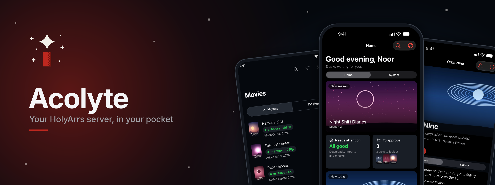</p>

# Acolyte (for HolyArrs)

An unofficial app for [HolyArrs](https://github.com/HolyArrs/HolyArrs), the self-hosted media server, for Android, iPhone and Apple TV.

Acolyte talks to your own HolyArrs server over its `/api/v1` JSON API: there is no backend of ours in between, no account with us, no analytics and no ads. It is a separate project and is not affiliated with or endorsed by HolyArrs.

[Website](https://orellbuehler.github.io/acolyte/) · [Privacy policy](https://orellbuehler.github.io/acolyte/privacy/) · [Support](https://orellbuehler.github.io/acolyte/support/) · [Releases](https://github.com/OrellBuehler/acolyte/releases)

## Screenshots

**iPhone**

<p align="center">
  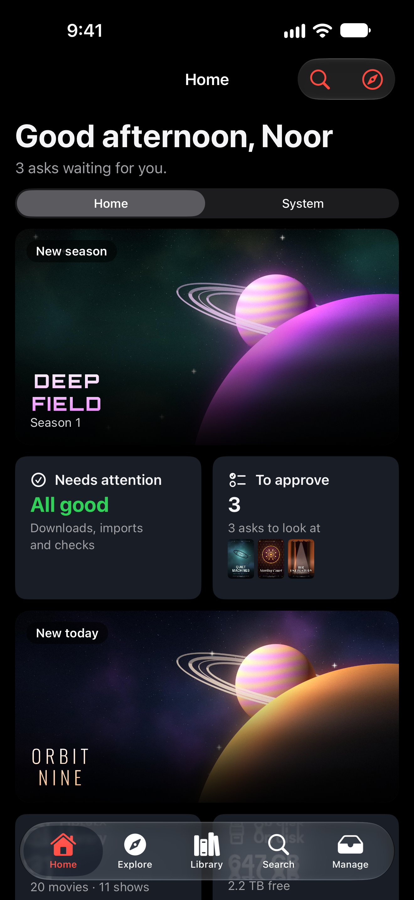
  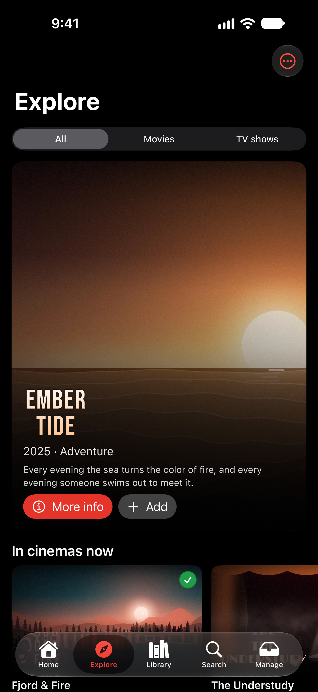
  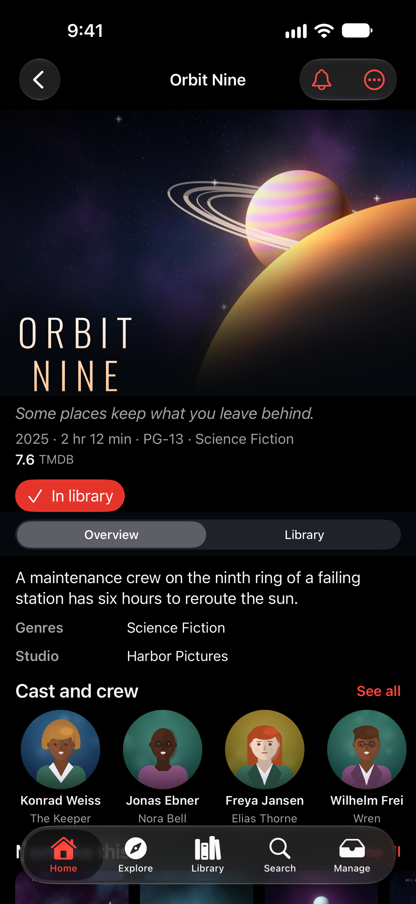
  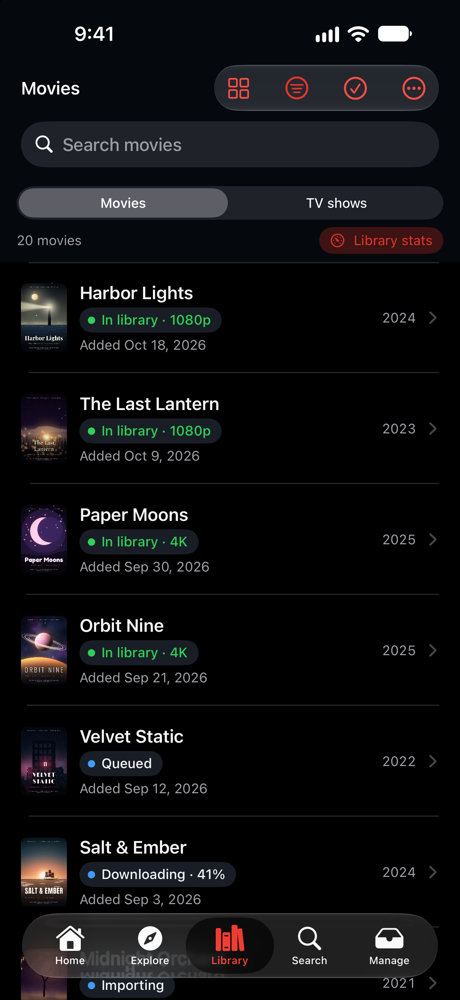
  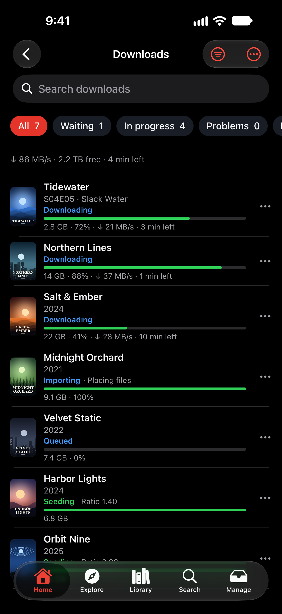
  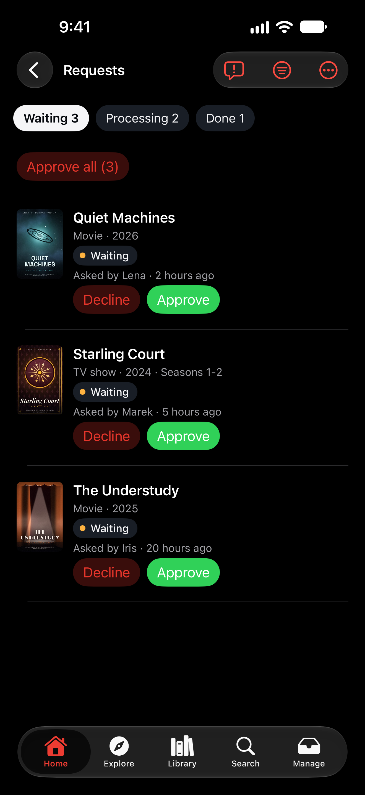
</p>

**Android**

<p align="center">
  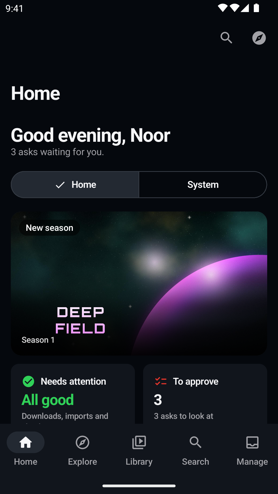
  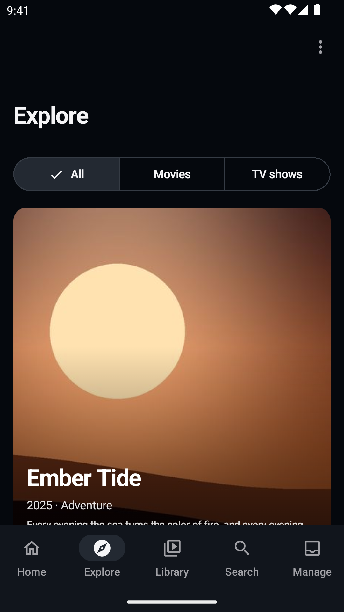
  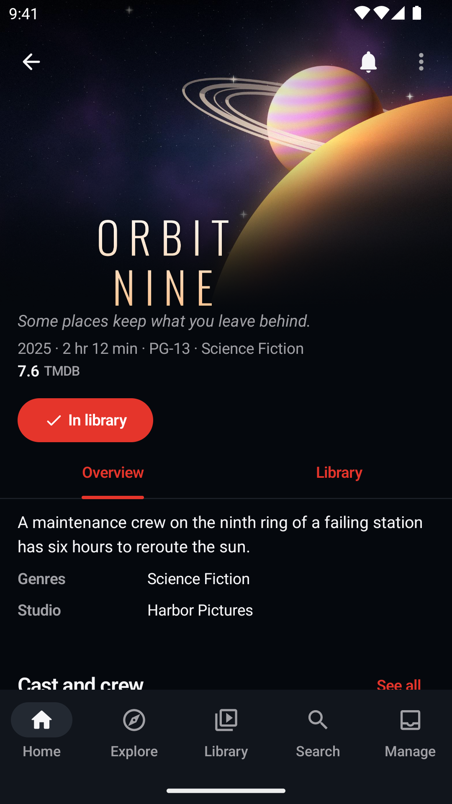
  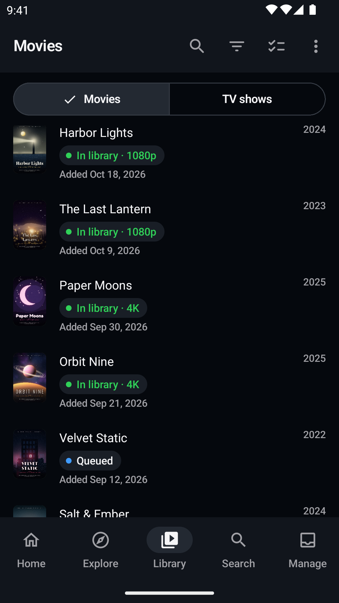
  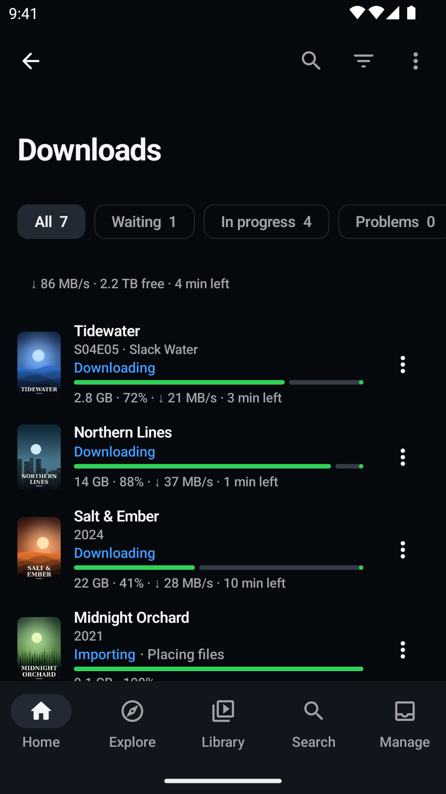
  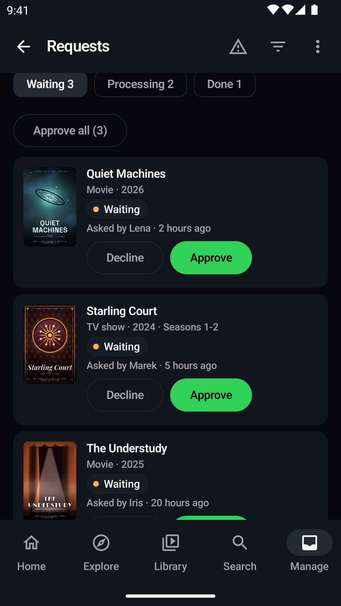
</p>

The pictures come from the `Store Screenshots` workflow and show invented demo data (see Store screenshots below). German sets are in `store/screenshots/*/de-DE/`.

## What it does

- **Home, Explore and Search**: what is new on your server, browsing by genre, person or collection, and title pages with cast, seasons, episodes and trailers.
- **Library**: films, series and music with filters you can save.
- **Requests**: ask for a title and follow it; approvers answer requests in the app.
- **Calendar and Downloads**: what is coming up and what the server is working on, updated live.
- **Manage** (for managers): status and health checks, people and permissions, and the server settings.
- **Sign-in**: HolyArrs password with two-factor, a Jellyfin, Emby or Plex account, or an API key. Secrets are kept in the Android Keystore or the Apple Keychain. Single sign-on (OIDC) is not supported yet.
- English and German, light and dark mode.

## Status

In testing. Signed builds of every [release](https://github.com/OrellBuehler/acolyte/releases) go to the Google Play internal testing track and to TestFlight; the app is not in the stores yet. The Apple TV app (`AcolyteTV`: Home, Explore, Search, Calendar, Downloads, Requests and Settings, without the manager tools) and the Android TV app (`androidTvApp`, same screens, being built up) build in CI but are not part of the release builds yet.

## How it fits together

| Part | What it is |
|---|---|
| `shared/` | Kotlin Multiplatform: the HolyArrs client (Ktor), sign-in and session, secure storage (Android Keystore, iOS Keychain), live updates (`/live`), image URLs, navigation rules and one presenter per feature. `AcolyteSdk` is the entry point. |
| `androidApp/` | Jetpack Compose and Material 3. Renders the shared state. |
| `androidTvApp/` | The Android TV app (Compose for TV), same application id as the phone app. Renders the same shared state with D-pad navigation. |
| `androidCommon/` | Small Android library both Android apps use: the palette, server images, error texts and the session view model. |
| `iosApp/` | SwiftUI (iPhone app `Acolyte` and the Apple TV app `AcolyteTV` on the same shared code), project generated with [XcodeGen](https://github.com/yonaskolb/XcodeGen). Uses the shared framework through [SKIE](https://skie.touchlab.co). |
| `api/` | The OpenAPI spec of the HolyArrs release the app is built against (`VERSION`). |

Every endpoint the app calls is declared once in `shared` and checked against that spec in CI, and a CI job runs the client against the published HolyArrs Docker image of the same release. [CLAUDE.md](CLAUDE.md) has the conventions for adding endpoints and screens.

Connecting: enter the server address as you open HolyArrs in a browser, including a URL base such as `/holyarrs`. Without a scheme the app tries HTTPS first, then HTTP. On iPhone and Apple TV plain HTTP works on the local network only; remote servers need HTTPS with a trusted certificate (for a self-signed one, install its certificate authority on the device). Android also accepts plain HTTP for remote servers, but use HTTPS there: over HTTP your sign-in travels unencrypted. A host name other than an IP address must be in the server's allowed host names (HolyArrs Settings, Sign-in and security).

## Build

### Android

Requirements: JDK 17 and the Android SDK (set `ANDROID_HOME` or `sdk.dir` in `local.properties`). `compileSdk` is 37, `minSdk` is 26.

```sh
./gradlew androidApp:assembleDebug        # debug APK in androidApp/build/outputs/apk/debug/
./gradlew shared:allTests                 # shared module tests (the iOS test targets only run on macOS)
./gradlew androidApp:testDebugUnitTest    # Android unit tests
./gradlew androidApp:lintDebug            # Android lint
./gradlew shared:ktlintCheck androidApp:ktlintCheck
```

The Android TV app is the `androidTvApp` module and has the same tasks (`androidTvApp:assembleDebug`, `androidTvApp:testDebugUnitTest`, `androidTvApp:lintDebug`, `androidTvApp:ktlintCheck`); the shared library module is `androidCommon` (`androidCommon:lintDebug`, `androidCommon:ktlintCheck`). To try the TV app, install the debug APK on an Android TV device or emulator (an `Android TV` system image) with `adb install androidTvApp/build/outputs/apk/debug/androidTvApp-debug.apk`.

### iOS

Requires macOS with Xcode, JDK 17 and XcodeGen (`brew install xcodegen`). The deployment target is iOS 18. These are the steps CI runs:

```sh
./gradlew shared:linkDebugFrameworkIosSimulatorArm64

SDK_NAME=$(xcrun --sdk iphonesimulator --show-sdk-version)
DEST="shared/build/xcode-frameworks/Debug/iphonesimulator${SDK_NAME}"
mkdir -p "$DEST"
cp -R shared/build/bin/iosSimulatorArm64/debugFramework/shared.framework "$DEST/"

cd iosApp
xcodegen generate
xcodebuild build \
  -project Acolyte.xcodeproj \
  -scheme Acolyte \
  -destination 'generic/platform=iOS Simulator' \
  -configuration Debug \
  CODE_SIGNING_ALLOWED=NO \
  ARCHS=arm64
```

`ARCHS=arm64` because the staged framework is the arm64 simulator slice. The Kotlin/Native tests of the shared module run with `./gradlew shared:iosSimulatorArm64Test`. To run the app, open `iosApp/Acolyte.xcodeproj` after the steps above.

The Apple TV app is the `AcolyteTV` scheme of the same project. Build `shared:linkDebugFrameworkTvosSimulatorArm64`, copy `shared/build/bin/tvosSimulatorArm64/debugFramework/shared.framework` to `shared/build/xcode-frameworks/Debug/appletvsimulator<sdk version>/` (CI does exactly this in `ios.yml`, job `tvos-build`), run `xcodegen generate` and build with `-destination 'generic/platform=tvOS Simulator'`. The tvOS Kotlin tests run with `./gradlew shared:tvosSimulatorArm64Test`.

### Against a real server

With Docker, `scripts/api/live-server.sh` starts the HolyArrs image of the release in `api/VERSION` on `http://127.0.0.1:6262`, finishes its setup and prints a user, password and API key:

```sh
eval "$(scripts/api/live-server.sh)"
./gradlew shared:testDebugUnitTest --tests '*LiveContractTest*'
scripts/api/live-server.sh stop
```

## Continuous integration

| Workflow | Runs on | What it does |
|---|---|---|
| `android.yml` | pull requests and pushes to `main`, manual | ktlint, shared module build, debug APKs of the phone and TV apps (uploaded as artifacts), Android lint, shared and Android unit tests (phone and TV), informational Kover coverage. `android-gate` is the always-reporting required check. |
| `ios.yml` | pull requests and pushes to `main`, manual | `ios-build` (string table check, shared framework and simulator app build, the fast compile signal), then `ios-tests` (Kotlin/Native tests of `shared`). `ios-gate` is the always-reporting required check. |
| `api.yml` | pull requests and pushes to `main`; weekly and manual for the drift report | `spec`: `api/openapi.json` equals the spec of the release in `api/VERSION`. `contract`: every endpoint the client declares exists in the spec with the same parameters, permission and part, and its models fit the typed schemas. `live`: the published Docker image of that release, set up over the API, answers every read endpoint (password and API key sign-in, strict decoding). `drift` (weekly, manual): compares with the latest HolyArrs release and `main`, writes the job summary and opens or updates an `api-drift` issue when a newer release exists or an endpoint the app uses changed. `api-gate` is the always-reporting required check. |
| `release.yml` | published GitHub release, manual dispatch | Signed release builds, see below. |
| `pages.yml` | pushes to `main` that touch `site/**`, manual | Deploys the website in `site/` to GitHub Pages, see Website. |
| `store-screenshots.yml` | manual dispatch; pull requests that touch the screenshot files | Store screenshots for both stores, see below. Not a required check. |

To move to a new HolyArrs release: `scripts/api/update-spec.sh [tag]` (default: the latest release), then fix what the contract and live tests report. The iOS jobs run on GitHub's `xcode-27` image with the Xcode 27.0 GM pinned and verified by `.github/actions/ios-setup`. Dependabot proposes weekly Gradle and GitHub Actions updates (Kotlin is bumped by hand together with SKIE).

## Store screenshots

The `Store Screenshots` workflow (Actions tab, Run workflow) captures the App Store and Google Play screenshots without anyone running the app: an emulator (Android) and a simulator (iPhone Pro Max) run the Debug apps against `scripts/screenshots/demo-server.py`, a small HolyArrs stand-in (Python standard library only) that answers the `/api/v1` calls of the captured screens from the invented catalog in `scripts/screenshots/catalog.py` (invented titles, people and generated artwork, see `scripts/screenshots/art/NOTICE.md`). The apps go through the normal sign-in flow; only the Debug builds read the launch arguments (iOS) or intent extras (Android) in `ScreenshotLaunch.swift` / `ScreenshotLaunch.kt` that sign in and open a screen. The language follows the apps' own locale (English, and German with the Swiss locale), dark mode, clean status bar (9:41, full battery).

| Where | What |
|---|---|
| Artifacts `ios-store-screenshots`, `android-store-screenshots` | The PNGs, laid out like `store/screenshots/` |
| `store/screenshots/ios/<locale>/iphone-6.9/NN-name.png` | 1320 x 2868, the App Store 6.9 inch slot |
| `store/screenshots/android/<locale>/phone/NN-name.png` | 1080 x 1920, Google Play phone screenshots |

Locales are `en-US` and `de-DE` (the app runs as `de-CH` for the German set). Tick `commit` when running the workflow to put the new PNGs on the branch `store-screenshots/refresh` and open a pull request; a plain run only uploads the artifacts.

Locally, `python3 scripts/screenshots/demo-server.py` serves the demo data on port 6263 (sign in with any user and password), and `ACOLYTE_DEMO_URL=http://127.0.0.1:6263 ./gradlew shared:testDebugUnitTest --tests '*DemoServerTest*'` checks that the shared presenters accept it, with strict decoding. To add a screen: add a line to `scripts/screenshots/screens.sh` (a section name or `title:<kind>:<tmdb id>`), serve what the screen calls in `demo-server.py` (the log lists every call it did not know), and look at the result in the next workflow run. New artwork: add the title to `catalog.py` and run `scripts/screenshots/make-art.py` (needs Pillow).

## Release

Every store build belongs to a [GitHub release](https://github.com/OrellBuehler/acolyte/releases): publishing a release (tag such as `v1.0.0`) runs `release.yml`, and the tag is the version in both stores. Starting the workflow by hand from the Actions tab (inputs: `version`, and `platforms` = both, android or ios) only retries a platform of a release that already exists. The version must look like `1.2.3` or `v1.2.3`. Until the secrets exist the workflow does nothing on pushes and a release run fails in its first step, naming the missing secrets.

- **Versions**: the tag without `v` is the Android `versionName` and the iOS `MARKETING_VERSION`. The workflow run number is the iOS build number and is folded into the Android `versionCode` (`(major*10000 + minor*100 + patch) * 1000 + run number`), so re-runs always increase.
- **Android job**: builds a signed AAB and APK, uploads both as workflow artifacts, attaches them to the GitHub release as `acolyte-<version>.apk` and `.aab`, and uploads the AAB to the Google Play internal testing track when `GOOGLE_PLAY_SERVICE_ACCOUNT_JSON` is set.
- **iOS job**: checks the stored provisioning profile, builds the shared release framework, archives with App Store Connect API key cloud signing, removes the development certificates that cloud signing created, exports with manual signing (Apple Distribution certificate and the stored profile), verifies the signature and uploads to TestFlight. The IPA is kept as workflow artifact.

| Secret | Job | Content |
|---|---|---|
| `ANDROID_KEYSTORE_BASE64` | Android | The signing keystore, base64 on one line: `base64 -w0 release.jks \| gh secret set ANDROID_KEYSTORE_BASE64` |
| `ANDROID_KEYSTORE_PASSWORD` | Android | Keystore password |
| `ANDROID_KEY_ALIAS` | Android | Key alias in the keystore |
| `ANDROID_KEY_PASSWORD` | Android | Password of that key |
| `GOOGLE_PLAY_SERVICE_ACCOUNT_JSON` | Android, optional | Play Console service account JSON (plain text). Without it the Play upload is skipped. The app `ch.orellbuehler.acolyte` must exist in the Play Console first; a brand-new app may refuse the `completed` release status, then do the first upload by hand. |
| `APP_STORE_CONNECT_API_KEY_BASE64` | iOS | The `.p8` App Store Connect API key (role Admin or App Manager): `openssl base64 -A -in AuthKey_XXXXXXXXXX.p8 \| gh secret set APP_STORE_CONNECT_API_KEY_BASE64` |
| `APP_STORE_CONNECT_KEY_ID` | iOS | Key ID of that API key |
| `APP_STORE_CONNECT_ISSUER_ID` | iOS | Issuer ID of the App Store Connect account |
| `APPLE_TEAM_ID` | iOS | Apple developer team ID (injected into `iosApp/ExportOptions.plist` during the job) |
| `IOS_DIST_CERT_P12_BASE64` | iOS | Apple Distribution certificate with private key, exported as `.p12`, base64 on one line |
| `IOS_DIST_CERT_PASSWORD` | iOS | Password of the `.p12` |
| `IOS_PROFILE_APP_BASE64` | iOS | App Store provisioning profile for `ch.orellbuehler.acolyte`, base64 on one line: `openssl base64 -A -in Acolyte_App_Store.mobileprovision \| gh secret set IOS_PROFILE_APP_BASE64` |

One-time iOS setup: register the App ID `ch.orellbuehler.acolyte`, create the app in App Store Connect, and create the App Store provisioning profile with the exact name `Acolyte App Store` (the name `iosApp/ExportOptions.plist` refers to). The app uses no capabilities yet; if it gains some, regenerate the profile and update the secret.

## Website

The public site (landing page, privacy policy, support page, in English and German) is plain static HTML and CSS in `site/`, with no build step and no external requests. English lives at the root (`site/index.html`, `site/privacy/`, `site/support/`), German under `site/de/`, shared files in `site/assets/`. Links are relative, so the site works under the `/acolyte/` path of GitHub Pages and at `/` in a local preview.

It is served at https://orellbuehler.github.io/acolyte/ and deployed by `.github/workflows/pages.yml` on every push to `main` that touches `site/**` (or can be started by hand). Pages must be switched on once in the repository settings (Settings, Pages, Source: GitHub Actions). The store listings use `/privacy/` as the privacy policy URL and `/support/` as the support URL.

Preview locally:

```sh
python3 -m http.server -d site 8000   # then open http://localhost:8000
```

When a change in the app alters what it stores or which hosts it contacts, update both privacy pages (`site/privacy/index.html` and `site/de/privacy/index.html`) and the effective date in the same change.

## Icon and store graphics

`scripts/store/make-promo.py` (needs inkscape, ImageMagick and the Inter font) draws the README banner (`assets/readme/banner.png`), the App Store header and search-result images (`assets/store/appstore-*.png`), the website's sharing picture and its screenshots (`site/assets/og.png`, `site/assets/screens/`) from `store/screenshots/`; run it after new screenshots are merged. `assets/store/feature-graphic.svg` is the Google Play feature graphic.

The icon files are in `assets/icon`.

| File | Use |
|---|---|
| `icon.svg`, `icon-1024.png`, `icon-512.png` | App icon, full square (the store or the system rounds the corners) |
| `adaptive-foreground.svg`, `adaptive-foreground-1024.png` | Android adaptive icon foreground, on background `#05080D` |
| `icon-small.svg`, `icon-small-48.png`, `icon-small-32.png`, `icon-small-16.png` | Simplified drawing for 48 px and below |

The Android launcher icon (`androidCommon/src/androidMain/res/drawable/ic_launcher_*.xml`) is the same drawing as a vector; the iOS app icon is `icon-1024.png` flattened onto `#05080D` (App Store icons cannot have an alpha channel).
